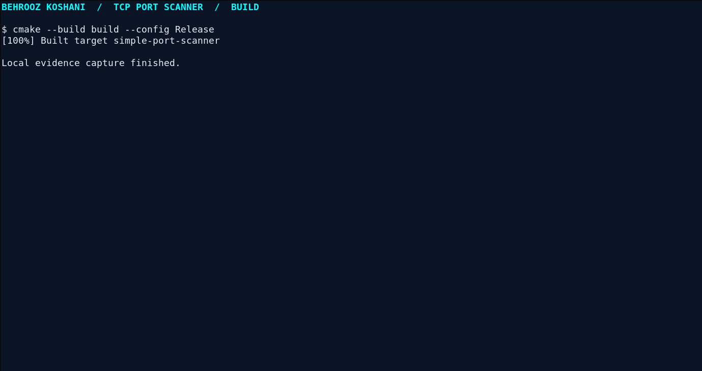
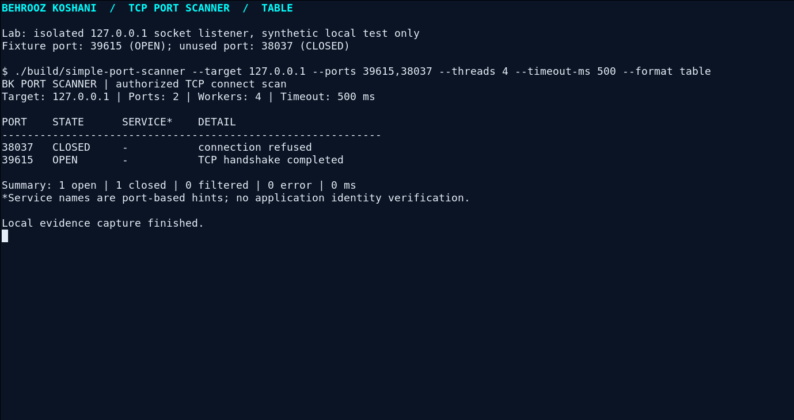
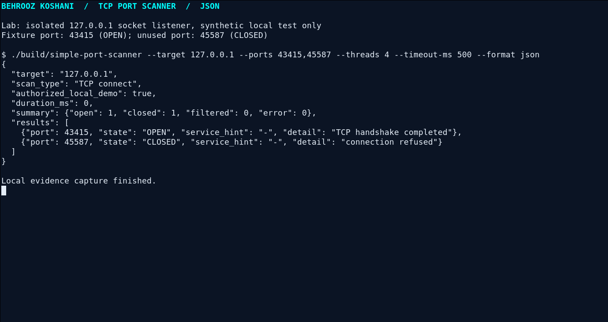
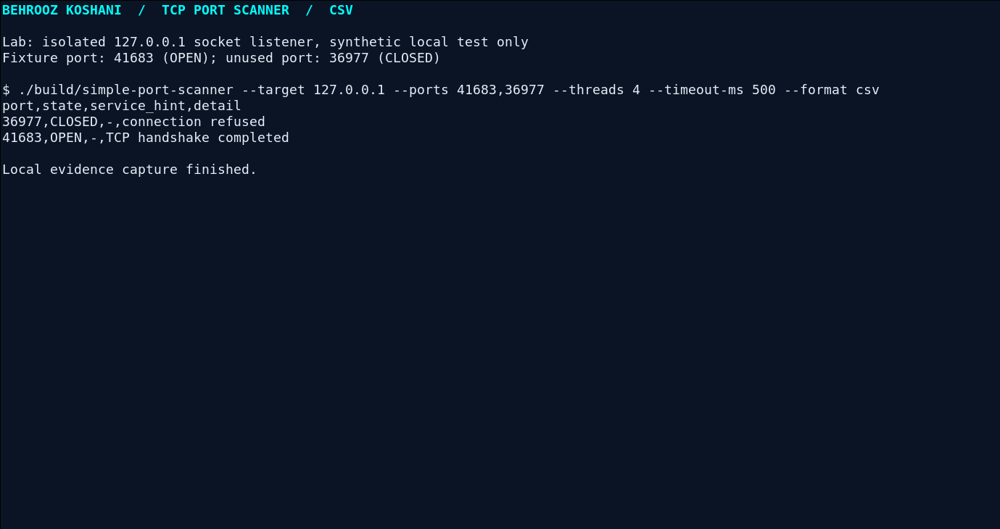
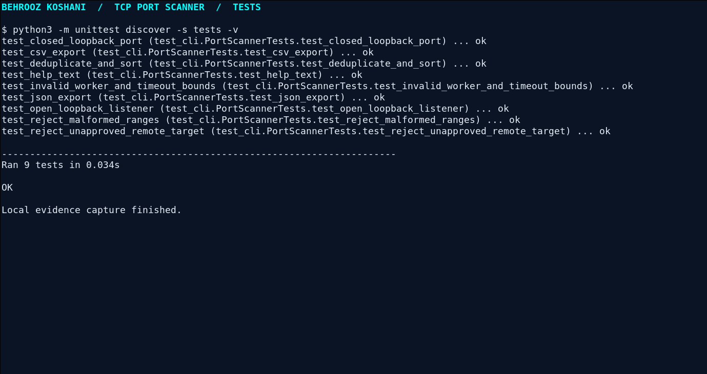
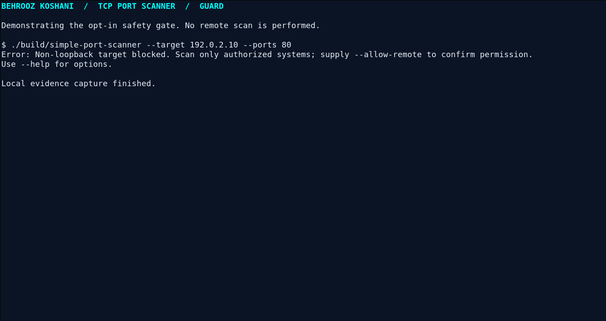

# Simple Port Scanner — Authorized TCP Connect Lab

**Behrooz Koshani** · C++20 · Networking · Cybersecurity · Security Engineering

> **Lab scope:** The screenshots in this repository show real executions of the included program, compiled and run against **local, temporary test sockets on `127.0.0.1`**. They are not screenshots of a corporate network, a vulnerability assessment, or an external host.

## Overview

I put this project together to demonstrate what happens during a TCP connect scan and how security teams can use basic network visibility to validate exposed services. The scanner is a C++20 command-line application that attempts a regular TCP connection to each selected port, records the outcome, and produces a readable report. Rather than copying an existing tool, the source is an independently written implementation designed for repeatable, permission-based testing.

A successful connection means that something accepted the TCP handshake on that address and port **at the time of the test**. It does **not** prove which application is running, whether the service is vulnerable, or whether a firewall is correctly configured.

This project was inspired by the *simple-port-scanner* learning project in [CarterPerez-dev/Cybersecurity-Projects](https://github.com/CarterPerez-dev/Cybersecurity-Projects/tree/main/PROJECTS/beginner/simple-port-scanner). The implementation, test harness, and execution captures in this repository were created separately.

## Objectives and scope

- Implement a reliable, bounded-concurrency **TCP connect** scanner in C++20.
- Support individual ports and ranges such as `22,80,443,8000-8005`, with validation and duplicate removal.
- Report **OPEN**, **CLOSED**, **FILTERED** (timeout), or **ERROR** with explanatory details.
- Export structured **JSON** or **CSV** for troubleshooting, inventory reviews, and follow-on analysis.
- Demonstrate an **authorized localhost-only test environment** with actual run screenshots.
- Test error handling, sorting, input boundaries, local open/closed ports, and the remote-authorization gate.

**Out of scope:** SYN/stealth scanning, packet crafting, OS fingerprinting, banner grabbing, brute force, service exploitation, and enterprise network discovery. This is a TCP connect and socket programming lab, not an alternative to Nmap or a vulnerability scanner.

## Tools and environment

| Component | Purpose |
| --- | --- |
| C++20 standard library | CLI parsing, worker threads, output formatting |
| TCP sockets and `select()` | Standard TCP connection attempts and timeouts |
| CMake 3.16+ | Reproducible build and CTest integration |
| Python 3.9+ standard library | Temporary loopback listeners and automated integration tests |
| Linux | Actual build, test, and screenshot capture environment |
| Windows | Winsock2-compatible source and a Windows CI build/test configuration (not locally verified) |

**Dependencies:** C++20 compiler, CMake, and Python for tests. No Boost installation, administrator privileges, external API keys, or additional Python packages are required.

## Build and run

### 1. Compile the scanner (Linux or WSL)

```bash
cmake -S . -B build -DCMAKE_BUILD_TYPE=Release
cmake --build build --parallel
```

### 2. Check the usage and run a local scan

```bash
./build/simple-port-scanner --help
./build/simple-port-scanner --target 127.0.0.1 --ports 22,80,443,8080 --threads 8 --timeout-ms 500
```

The default target is `127.0.0.1`; **non-loopback targets are rejected** unless `--allow-remote` is explicitly provided. That flag is a confirmation of permission, not an authentication or access-control mechanism. Only use it when the target owner has authorized the test.

### 3. Reproduce the real local evidence

The demo script creates a temporary listening socket on `127.0.0.1`, selects another unused local port, runs the compiled scanner while the listener is active, then closes the listener automatically. The demo does **not** scan an external IP.

```bash
python3 scripts/demo_local.py --mode table
python3 scripts/demo_local.py --mode json
python3 scripts/demo_local.py --mode csv
python3 scripts/demo_local.py --mode guard
```

Port numbers are assigned dynamically by the operating system, so your results will use different numbers from the screenshots.

### 4. Export results

```bash
./build/simple-port-scanner --target 127.0.0.1 --ports 22,80,443,8080 --format json --output results.json
./build/simple-port-scanner --target 127.0.0.1 --ports 22,80,443,8080 --format csv --output results.csv
```

### 5. Verify the tests

```bash
python3 -m unittest discover -s tests -v
ctest --test-dir build --output-on-failure
```

The included automated suite has **nine tests** using local fixtures; it makes no outbound scan requests. The GitHub Actions workflow is configured to build and test on Linux and Windows. [Windows build notes](docs/WINDOWS.md).

## How the scanner works

1. I parse and validate the port specification, removing duplicates and sorting the ports.
2. The program resolves the chosen hostname to an IPv4 address, then blocks non-loopback IPs by default.
3. I use a worker pool with a configurable maximum of 256 concurrent connection attempts to bound resource use.
4. Each worker opens a nonblocking TCP socket, calls `connect()`, and uses `select()` plus `getsockopt(SO_ERROR)` to observe the outcome before the timeout.
5. Results are sorted by port and printed as a terminal table, JSON, or CSV. The service field is **only a conventional-port hint**; no application-layer identification is attempted.

For a deeper breakdown, see [Architecture](docs/ARCHITECTURE.md) and [Walkthrough](docs/WALKTHROUGH.md).

## Screenshot evidence — captured during actual local runs

Each image below is a screenshot of the terminal running code from this repository, not a mockup or an illustration. The host is a loopback interface and the sample listener is temporary.

### 1. Successful CMake build



*Evidence:* `cmake --build build --config Release` completed successfully with the executable target built. This confirms a successful build **on the documented Linux environment**, not a Windows build.

### 2. TCP scanning: open and closed localhost ports



*Evidence:* `python3 scripts/demo_local.py --mode table` started a real local socket listener. The scanner reported one **OPEN** port and one **CLOSED** port. Port values are assigned dynamically, so they are not fixed test targets.

### 3. JSON reporting



*Evidence:* `python3 scripts/demo_local.py --mode json` returned structured port states and summary counts that an analyst could parse or include in a report.

### 4. CSV reporting



*Evidence:* `python3 scripts/demo_local.py --mode csv` produced a header and individual results, ready for spreadsheet review or file export.

### 5. Automated test results



*Evidence:* `python3 -m unittest discover -s tests -v` completed **9 tests successfully**, including open/closed ports, report exports, invalid inputs, and authorization checks.

### 6. Remote authorization control



*Evidence:* The program refused to run against `192.0.2.10` without `--allow-remote`. The documentation address was never scanned in this test.

See [Test Evidence](docs/TEST_EVIDENCE.md) for interpretation and reproducibility.

## Results and defensive takeaways

**Observed local results:** The demonstration correctly distinguished a temporary TCP listener that accepted connections from a port that refused connections. JSON and CSV output recorded the same state classifications, and nine automated integration tests passed. The guard test rejected a remote address by default.

**Security relevance:** Defenders can use connection testing for basic exposure inventories, firewall rule validation, and verifying whether an intended service is reachable. A detected open port should lead to **authorized** verification of the owning application, business need, patch status, authentication, and network controls. A closed or timed-out port does not conclusively prove that a system is secure.

**What I learned:** Basic TCP connectivity, nonblocking socket I/O, concurrency management, state classification, input validation, reproducible testing, structured reporting, and accurate evidence collection all matter when designing security tooling. Keeping the test environment isolated prevents accidentally scanning systems outside the authorized scope.

## Limitations

- TCP IPv4 only; no UDP scan or IPv6 endpoint support.
- Filtered status is inferred from a **timeout**, not proven firewall filtering. Other network errors are labeled ERROR.
- A port may change state between scans. A completed TCP handshake does not identify the application or prove a vulnerability.
- Service labels are based on common port numbers only and can be wrong.
- High concurrency may affect the target or scanner; use conservative settings and defined authorization.
- The lab captures only localhost fixtures. There is **no production network, internet target, or enterprise scan evidence** here.

## Repository structure

```text
simple-port-scanner/
├── README.md
├── CMakeLists.txt
├── LICENSE
├── src/
│   ├── main.cpp                  # CLI, exports and summaries
│   ├── scanner.cpp               # TCP socket engine and worker pool
│   └── scanner.hpp
├── scripts/
│   └── demo_local.py             # Authorized, self-contained localhost demonstration
├── tests/
│   └── test_cli.py               # Nine integration tests
├── screenshots/                  # Six genuine local terminal captures
├── docs/
│   ├── ARCHITECTURE.md
│   ├── WALKTHROUGH.md
│   ├── TEST_EVIDENCE.md
│   ├── SECURITY.md
│   └── WINDOWS.md
└── .github/workflows/ci.yml      # Cross-platform build and tests
```

**Maintainer:** Behrooz Koshani · [GitHub](https://github.com/behroozkoshani)  
**License:** MIT for this independent implementation.  
**Concept inspiration:** [CarterPerez-dev, *simple-port-scanner*](https://github.com/CarterPerez-dev/Cybersecurity-Projects/tree/main/PROJECTS/beginner/simple-port-scanner).
