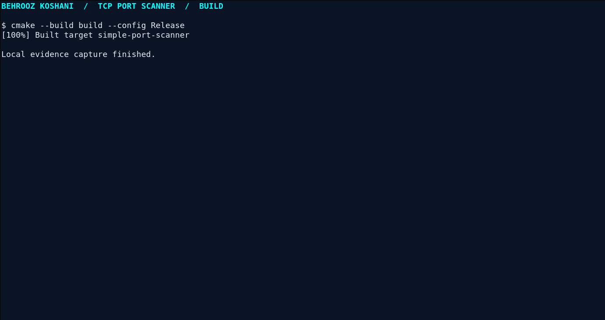
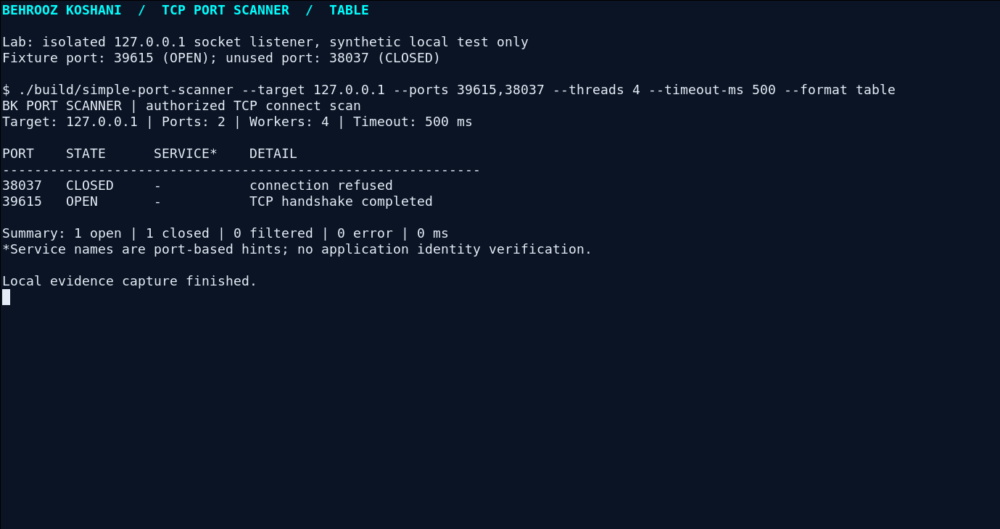
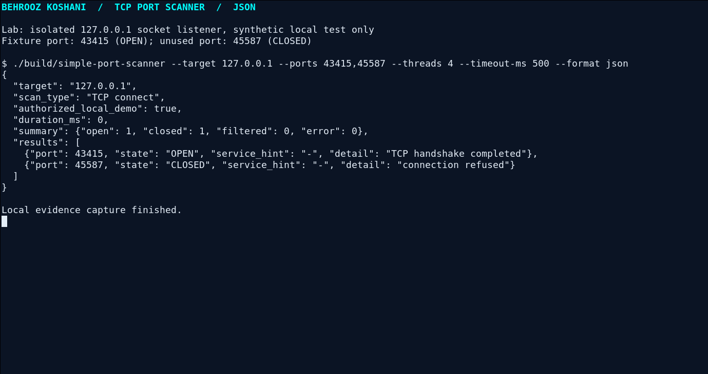
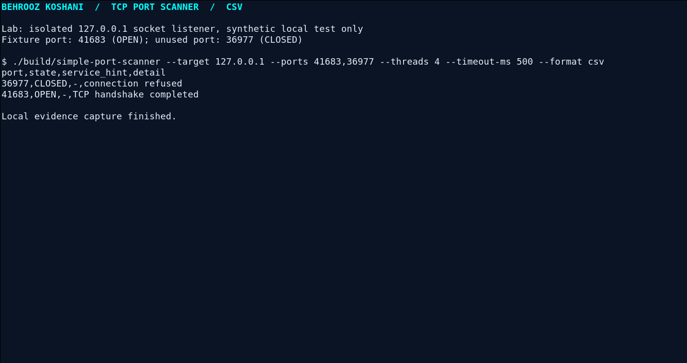
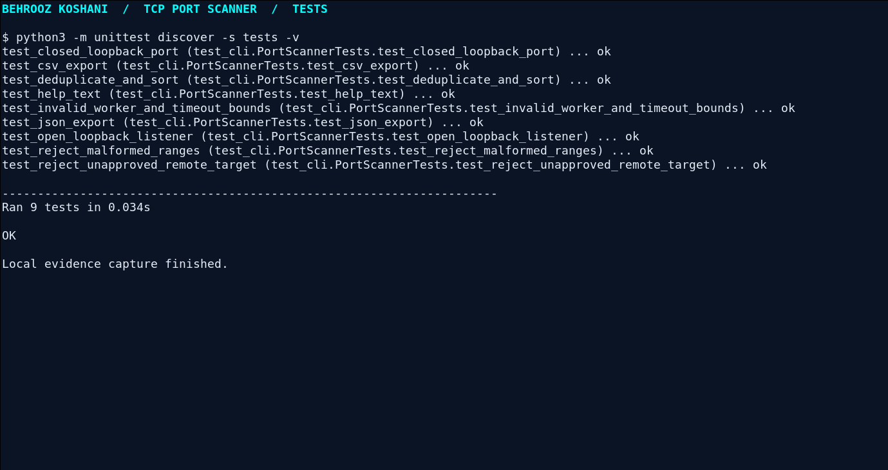
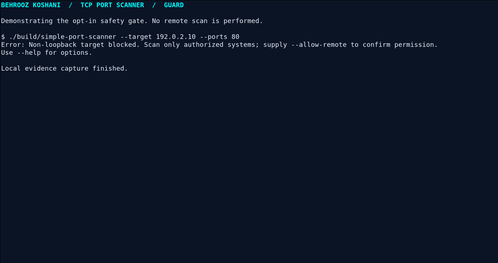

# Technical Walkthrough

This guide explains each stage of the lab in the order it was built and tested. All evidence is from a loopback-only, temporary TCP listener.

## Step 1 — Prepare the environment

Install a C++20 compiler (GCC 11+/Clang or MSVC with C++20 enabled), CMake 3.16+, and Python 3.9+. On Ubuntu/WSL, use the system package manager to obtain `g++`, `cmake`, and `python3` if not already installed.

Check tools:

```bash
g++ --version
cmake --version
python3 --version
```

## Step 2 — Build the binary

```bash
cmake -S . -B build -DCMAKE_BUILD_TYPE=Release
cmake --build build --parallel
```

The CMake project compiles `src/main.cpp` and `src/scanner.cpp` into `build/simple-port-scanner`. Standard TCP socket libraries are used without third-party code dependencies.



## Step 3 — Verify the help menu

```bash
./build/simple-port-scanner --help
```

The CLI accepts the target IPv4 host, a validated comma-separated list of individual ports and ranges, worker count, connection timeout, output format, and a report path.

## Step 4 — Start a real local fixture and scan it

Run:

```bash
python3 scripts/demo_local.py --mode table
```

The script opens a real listening TCP socket bound to `127.0.0.1`, learns its operating-system-assigned port number, reserves another temporary local port and releases it, and then invokes the C++ scanner against both ports. The listener stays open until the scan finishes. There is no simulated scanner output: the C++ binary determines the port states using actual socket calls.



The expected pattern is one **OPEN** result for the listening socket and one **CLOSED** result for the unused port. Exact numbers vary each run, and the unused port can theoretically be claimed by another process between selection and scan.

## Step 5 — Inspect machine-readable results

```bash
python3 scripts/demo_local.py --mode json
python3 scripts/demo_local.py --mode csv
```

JSON includes target, scan type, elapsed time, a status summary, and one item per port. CSV includes a flat header suitable for spreadsheet inspection. Both formats represent the same TCP observations; neither demonstrates application fingerprinting.





## Step 6 — Run tests

```bash
python3 -m unittest discover -s tests -v
ctest --test-dir build --output-on-failure
```

The Python harness launches the C++ program, uses ephemeral local fixtures for open-port checks, tests closed ports, validates JSON/CSV structure, and verifies rejection of invalid input and non-loopback addresses without the explicit opt-in flag.



## Step 7 — Confirm the default authorization gate

```bash
python3 scripts/demo_local.py --mode guard
```

The test passes the reserved documentation address `192.0.2.10`, which the scanner rejects with a validation error before attempting a TCP connection. An actual non-loopback scan is not part of this lab.



## Step 8 — Review findings and communicate responsibly

For a real, explicitly authorized environment, compare the confirmed open ports to the system's expected service inventory and firewall policy. Flag unexpected accessibility for the owner to investigate. Do not equate an open TCP port with exploitation or compromise, and do not claim the scanner performed vulnerability detection.
